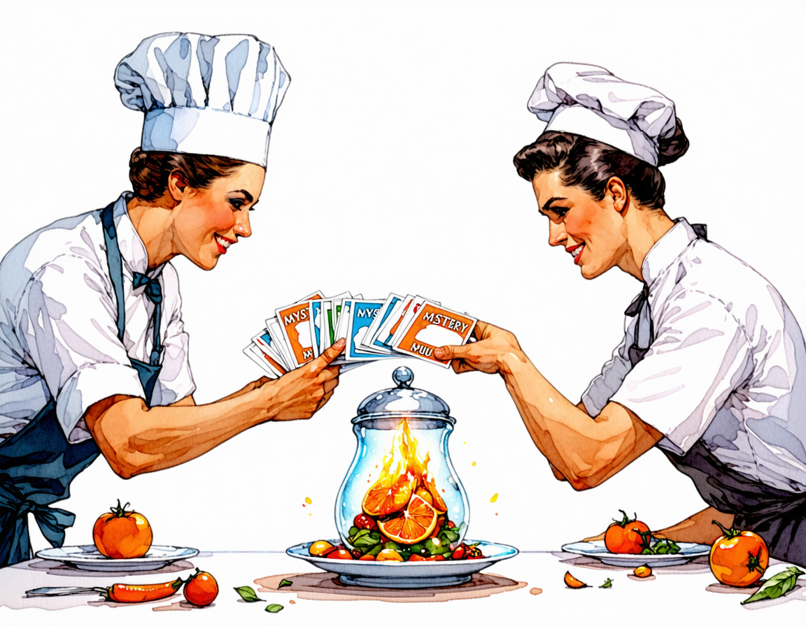

# Mystery Menu

**Two chefs. Five secret ingredients each. One table voting on the dish they would actually eat.**

Mobile-first party game. The host opens a room on their phone, the table scans a
barcode, and two of them are handed five ingredients apiece — generated behind the
scenes, shown to nobody, revealed one at a time by a 3D referee who talks. Every
ingredient goes to the highest bidder against a ten second clock. Then the table
votes.

<p align="center">
  
</p>

## How a match runs

| Phase | What happens |
|-------|--------------|
| **Lobby** | Host creates a room, everyone else scans the QR code and types a name. No accounts, no passwords, no email. |
| **Solo demo** | One phone can run the whole table: the host is seated as Director, two virtual chefs and three virtual diners are seeded, and every reveal, bid and ballot is driven from that screen. No second phone required. |
| **Deck** | A theme is drawn (Pizza, Bowls, Tacos, Indian, Chaos Mix) and ten ingredients are generated for the match, five per chef. Neither chef sees them. |
| **Auction** | The referee announces one ingredient. Both chefs bid upward from a budget of ten coins against a ten second clock. Concede with **Take it**. Run out of coins and you take everything left for free. |
| **Plating** | Both dishes assemble in 3D from their five ingredients, the cross-cuisine twist landing last. |
| **Vote** | The table votes once, anonymously, on the dish they would rather eat. Best of three rounds takes the match. |

The vegetarian filter swaps the whole ingredient pool, so a dish either is or is not
safe for the table before anybody bids on it.

## Solo demo

Tap **Start a solo demo** on the home screen. The server seeds a demo room with
two virtual chefs and three virtual diners, seats you as the Director, and hands
you every control:

- **Reveal** each ingredient as the referee.
- **Bid or take it** for either chef; only the chef whose clock is running can
  act. **Auto-bid Chef Two** (on by default) gives you a rival without a second
  phone.
- **Cast every diner's ballot** after opening the vote. The tally still releases
  as one aggregate, so the anonymity rule is unchanged. *Fill the rest at random*
  finishes a demo in one tap.

The demo is a real room with real rules — the virtual seats are server-side
seats, not a client-side simulation. Only the demo host may act for them, and a
second phone that joins cannot drive the chefs or cast a virtual ballot.

## Under the hood

- **Server** — Node, Express, socket.io. Rooms live in memory: a party room dies with the evening, and there is no database to leak.
- **Client** — Vite + TypeScript PWA, built for a 360px touch screen first.
- **3D** — Three.js: a stylised kitchen, one recurring referee character, lip sync driven by the audio it just spoke.
- **AI** — Venice models do the ingredient generation, the referee's lines, the ingredient art and the voice. Every key stays server-side.
- **Loop** — [Noodle](https://github.com/poteto/noodle) runs the build. The scheduled skills read `todos.md` and dispatch the work in isolated worktrees.

## Run it

```bash
npm install
npm test          # health endpoint + boot check
npm run typecheck
npm run build
npm start         # http://localhost:3000
```

`GET /healthz` returns `{"ok":true,"service":"mystery-menu"}`.

Live: https://mystery-menu-production.up.railway.app — Railway deploys `main` on push.

## Layout

```
.agents/skills/   Noodle skills: schedule, execute, quality
adapters/         backlog adapters that read todos.md
docs/DESIGN.md    the locked product spec — read this first
server/           Express + socket.io
src/              PWA client
tests/            boot and health coverage
todos.md          the backlog Noodle works through
```

---

Built for a dinner table, not a leaderboard.
